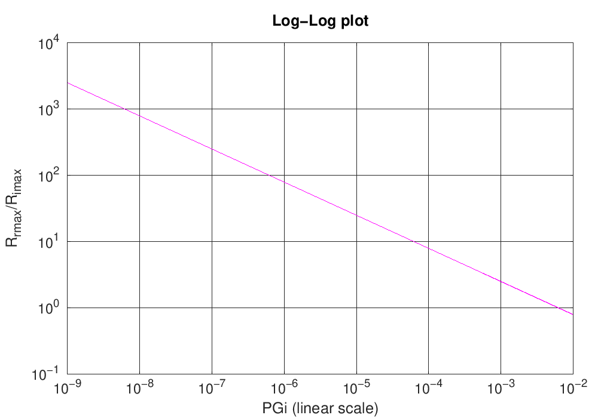
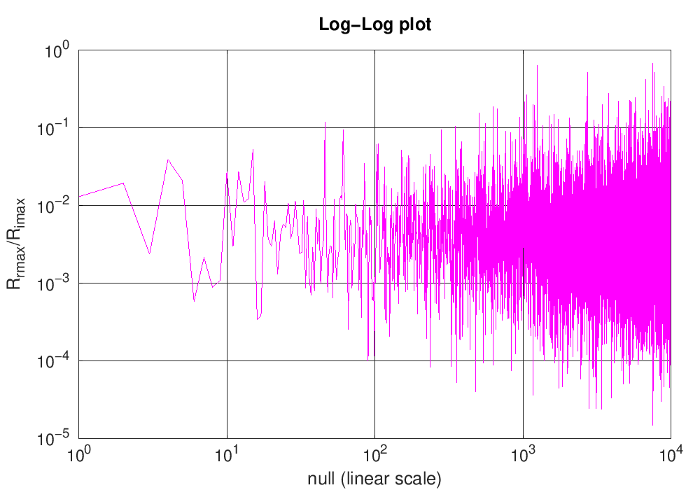

# lpi-intercept-sim: how low is "low probability of intercept"?

lpi-intercept-sim is a MATLAB program that pits a low-probability-of-intercept (LPI) radar against a
non-cooperative intercept receiver. It compares the radar's maximum detection range with the
receiver's maximum interception range, over 10,000 parameter sets, and counts how often the radar
sees first. It then estimates how quickly the receiver's beam and the radar's beam line up as both
antennas scan, and combines the two into a probability of intercept over time.

It was written in 2008 by ion- (dated 24 April 2008). The MATLAB code in `src/` is
the 2008 code, unchanged except for the file name of the main script (`lpiInterceptSim.m`), the
header comments and the top line of the program banner.



*PGi sweep: radar range ÷ receiver range as the receiver's processing gain rises from 10⁻⁹ to
10⁻². The radar keeps a processing gain of 10⁸ throughout. Replayed in GNU Octave.*

## What it models

**Stage 1: who sees whom first.** For each parameter set the program computes the radar's
maximum detection range (two-way path) and the receiver's maximum interception range (one-way path):

```
R_r,max = [ P·Gt·Gr·c²·σ·L2·PGr / ( fc²·(4π)³·k·T0·Fr·Br·SNRr·Lrt·Lrr ) ]^(1/4)
R_i,max = [ P·Gt'·Gi·L1·c²·PGi  / ( fc²·(4π)²·Lrt·Lir·k·T0·Fi·Bi·SNRi ) ]^(1/2)
```

P is the radar's average power, Gt and Gr its antenna gains, σ the target's radar cross section,
PGr the radar's processing gain (its time-bandwidth product), F the noise factors, B the input
bandwidths, SNR the required output signal-to-noise ratios, L the losses, and Gt' the radar antenna
gain in the receiver's direction. The radar "wins" a comparison when R_r,max > R_i,max.
All values are in SI units and linear (not dB).

Three input functions supply the parameters:

| Option | Input function | What it does |
|---|---|---|
| 1 | `parameters_1.m` | Three predefined radar/receiver pairs (see the notes below) |
| 2 | `parameters_2.m` | Every parameter drawn at random, 10,000 times, between fixed upper bounds |
| 3 | `parameters_3.m` | Everything fixed except the receiver's processing gain PGi, stepped 10,000 times from 10⁻⁹ to 10⁻² |

The parameter values are generic textbook-style numbers. They do not describe any real radar or
receiver.

**Stage 2: beam coincidence.** `windowing.m` treats each scanning antenna as a window function
(dwell τ = beamwidth ÷ rotation rate, period T = 360° ÷ rotation rate). The receiver must dwell for
at least four code periods of the LPI waveform, so its window is shortened by 4·T_code. From the
two windows it computes the mean time between coincidences T0 = T1·T2 / (τ1 + τ2), the probability
at t = 0, P0 = τ1·τ2 / (T1·T2), and the probability of main-lobe-to-main-lobe interception by time t:

```
P(t) = 1 − (1 − P0)·exp(−t / T0)
```

**Combined.** The probability of intercept is P(t) × (fraction of comparisons the receiver won).

The program prints the win percentages and draws three figures: the range ratio (log-log), P(t),
and the combined probability of intercept.

## What the runs show

These are the results of the saved runs in `examples/`, replayed in GNU Octave 9.4.0:

| Run | Radar processing gain | Radar wins | Range ratio R_r/R_i (median) |
|---|---|---|---|
| PGi sweep (option 3) | 10⁸ (80 dB), fixed | 6,222 of 10,000 (62.22%) | 1.12 |
| All random (option 2), seeds 1–5 | random, up to 10⁹ | 0, 1, 3, 0, 1 of 10,000 | 0.0038 to 0.0039 |

- **PGi sweep.** With the radar's time-bandwidth product fixed at 10⁸ (80 dB), the receiver
  out-ranges the radar as soon as its own processing gain exceeds 6.22 × 10⁻³ (about −22 dB, a
  receiver with net processing *loss*). Above that point the receiver wins every comparison.
- **All random.** Across five seeds the radar won at most 3 of 10,000 comparisons. The median
  radar range was under 0.4% of the receiver's range.

In these runs, a large time-bandwidth product did not make up for the radar's two-way path loss
against the receiver's one-way path. Once the beams coincide, the receiver almost always detects the
radar before the radar detects its target. How soon the beams coincide is set by the scan
parameters (stage 2).



*All-random run, seed 1: radar range ÷ receiver range for each of the 10,000 random parameter sets
(trial number on the x axis, labelled "null" by the program). Values above 1 are radar wins.*

## Running it

### MATLAB

Put the files of `src/` on the MATLAB path (or `cd src`) and run:

```matlab
lpiInterceptSim
```

The program asks for a verbose flag (0 or 1), the input function (1–3), and then five scan
parameters: radar rotation rate (deg/s), radar beamwidth (deg), receiver rotation rate (deg/s),
receiver beamwidth (deg) and the LPI code period (s).

### GNU Octave

The code runs unchanged in GNU Octave (checked with Octave 9.4.0 on Debian 13). To use it
interactively, start Octave in `src/` and run `lpiInterceptSim` at the prompt.

To replay a saved run without typing, feed an example file on standard input. `run-example.sh` does
this headlessly. An optional second argument sets the random-number seed (default 2008), and an
optional third argument saves the three figures as PNGs:

```bash
./run-example.sh examples/pgi-sweep.txt                    # results only
./run-example.sh examples/all-random-seed3.txt 3           # random mode, seed 3
./run-example.sh examples/pgi-sweep.txt 2008 out/sweep     # also writes out/sweep-1.png … -3.png
```

The script needs `octave-cli` and `gnuplot` (Debian/Ubuntu: `sudo apt install octave gnuplot-nox`).
This batch mode needs no change to the program. The script:

1. selects Octave's gnuplot back end with hidden figures;
2. seeds the random-number generator with `rand('state', seed)`;
3. runs `lpiInterceptSim`, which reads its answers from the example file;
4. prints a `RESULT` summary from the variables the program leaves in the workspace (win count,
   range-ratio statistics, the PGi crossover, and P(t) at t = 1, 10, 100, 1,000 and 10,000 s);
5. saves the figures if asked.

| Example file | Run |
|---|---|
| `examples/pgi-sweep.txt` | Option 3; scan inputs 10 deg/s, 5°, 3 deg/s, 10°, 1 ms |
| `examples/all-random-seed1.txt` … `seed5.txt` | Option 2; scan inputs 10 deg/s, 3°, 5 deg/s, 10°, 1 ms (run with seeds 1–5) |

## Verification

`examples/expected/` holds the results of every saved run (115 values in all). `tools/verify.py`
replays each run and compares every value. The current result is 115 values compared and
0 mismatches. The value-by-value table is in [`docs/verification.md`](docs/verification.md).

```bash
python3 tools/verify.py
```

The PGi sweep uses no random numbers, so it can also be checked against the console output kept
from the original 2008 MATLAB run with the same inputs: "The LPI wins 62.220000%" and "The
Interceptor wins 37.780000%". The Octave replay prints the same two lines.

The random runs depend on the generator. The seeded results are reproducible in Octave, but MATLAB
gives different random numbers for the same seed. A kept 2008 MATLAB run of the all-random option
(unseeded) printed "The LPI wins 0.040000%", in line with the 0 to 0.03% of the seeded replays.

## Notes on the 2008 code

These are kept as they were in 2008 and documented here rather than fixed:

- **Option 1 stops before comparing.** `lpiInterceptSim.m` leaves the loop (`break`) right after
  loading the predefined pair and before the range equations, so option 1 always reports
  "The LPI wins 0.000000%". Predefined cases 2 and 3 in `parameters_1.m` are placeholders (all
  values 1). No example uses option 1.
- **The side-lobe model is not reached.** `scan_menu.m` (beamwidth and side-lobe reduction) is
  never called, so `scanning_antenna.m` always returns the main-lobe gain (Gt' = Gt). The range
  comparison is therefore main lobe to main lobe, and stage 2 supplies the probability that the
  main lobes meet. If it were enabled, `scanning_antenna.m` would need the side-lobe reduction as a
  fraction (0–1), although `scan_menu.m` asks for 0–100.
- **Random draws.** `parameters_2.m` draws each value as `ceil(MAX * rand())`, uniform up to the
  upper bound, so loss terms with an upper bound of 1 are always 1 (lossless). The value banks it
  builds with `linspace` are not used.
- `parameters_1.m` and `parameters_3.m` declare their function as `parameters`. MATLAB and Octave
  call a function by its file name, so this works; `run-example.sh` silences Octave's warning about it.
- The program banner and its spelling ("Duce" for a tie, "NUMBER_OF_COMPARISSONS") are as written in 2008.

## Repository layout

```
src/                  2008 MATLAB sources (main script lpiInterceptSim.m + 13 functions)
examples/             typed inputs for each saved run
examples/expected/    recorded results of every saved run
docs/verification.md  recorded value vs replay, every value
docs/*.png            figures from the Octave replays
run-example.sh        headless Octave runner (batch mode, seed, PNG export)
tools/verify.py       replays all runs and compares (--record rewrites examples/expected/)
tools/make_verification_md.py  regenerates docs/verification.md
```

## License

MIT. See [LICENSE](LICENSE).
